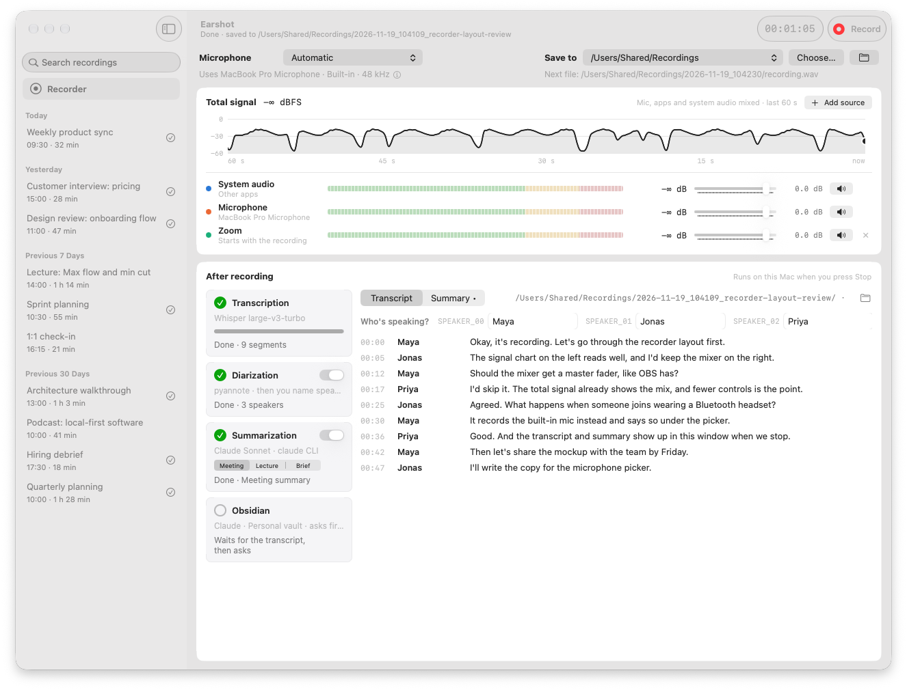
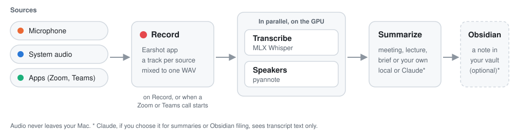
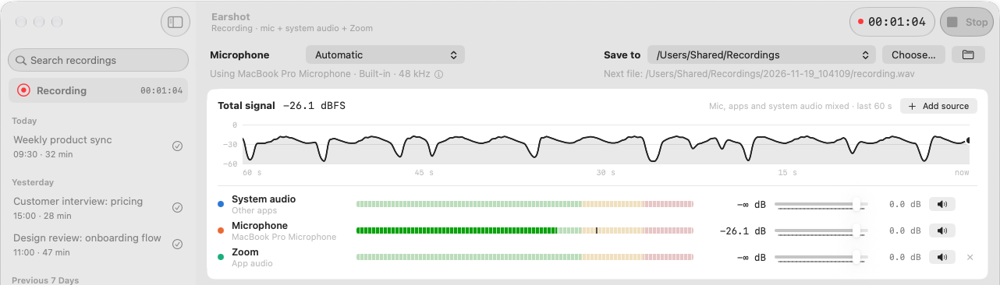
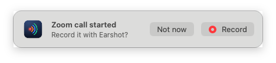

<p align="center">
  
</p>

<h1 align="center">Earshot</h1>

<p align="center">
  Record, transcribe and summarize meetings on your Mac. The audio never leaves it.
</p>

<p align="center">
  <a href="LICENSE"></a>
  
  
</p>

Earshot is a native Mac app for recording calls, lectures and conversations. It records your microphone,
the system audio and, if you want, single apps (Zoom, Teams, a browser) as separate sources, then turns
the recording into a transcript with speaker names, a summary, and optionally a note in your Obsidian
vault. Transcription and speaker identification run on your Mac's GPU.

It notices when a Zoom or Microsoft Teams call starts and asks whether to record it, then stops by
itself when the call ends.

<p align="center">
  
</p>

Earshot is a fork of [ownscribe](https://github.com/paberr/ownscribe) by Pascal Berrang. The Python
backend and command-line tool are still called `ownscribe`; Earshot is the Mac app on top of them, plus
MLX transcription, Obsidian filing and the capture work described below.

## Contents

- [How it works](#how-it-works)
- [Features](#features)
- [Requirements](#requirements)
- [Install](#install)
- [Using Earshot](#using-earshot)
- [Privacy](#privacy)
- [Configuration](#configuration)
- [Speaker identification](#speaker-identification)
- [Obsidian filing](#obsidian-filing)
- [The command-line tool](#the-command-line-tool)
- [Development](#development)
- [Acknowledgments](#acknowledgments)
- [License](#license)

## How it works

<picture>
  <source media="(prefers-color-scheme: dark)" srcset="docs/images/pipeline-dark.svg">
  
</picture>

Earshot records each source to its own track and mixes them into one file when you stop. The backend
then transcribes it with MLX Whisper while pyannote works out who spoke when, writes a summary with the
template you picked, and, if you set it up, drafts an Obsidian note for you to review.

## Features

- **Mixer.** Mic, system audio and any running app each get a meter, a fader and a mute button, with a
  60-second level chart above them. Each source is recorded to its own track, then mixed down.
- **Per-app capture.** Give an app its own source with Core Audio process taps. There are no virtual
  audio drivers, and the rest of the system audio stays on its own track.
- **Mic handling.** Earshot picks the mic automatically and skips a Bluetooth headset that macOS made the
  default input, using the built-in mic instead. A mic that only delivers silence is flagged while you
  record.
- **Call detection.** Earshot spots Zoom and Teams calls from which apps are using the mic and speakers,
  so it needs no extra permission. A small panel asks whether to record, and a recording started that way
  stops when the call ends.
- **On-device transcription.** [MLX Whisper](https://github.com/ml-explore/mlx-examples/tree/main/whisper)
  on the Apple GPU, with word-level timestamps.
- **Speaker identification.** [pyannote](https://github.com/pyannote/pyannote-audio) runs on the GPU
  alongside Whisper, and you name the speakers afterwards.
- **Summaries.** Templates for meetings, lectures and short briefs, or your own. They come from a built-in
  local model, Ollama, LM Studio, any OpenAI-compatible server, or the `claude` CLI.
- **Obsidian filing.** A recording becomes a categorized note in your vault, and you review it before it's
  written.
- **History.** Every past recording is in the sidebar, searchable. You can rename speakers, summarize
  again or file any of them.
- **Safe recordings.** A source that stops delivering audio is detected and reconnected, and the gap is
  logged. A crash leaves per-source tracks on disk that Earshot can rebuild into a recording.

## Requirements

- A Mac with Apple silicon and macOS 26 or later for the app. The command-line tool alone needs macOS
  14.2 or later.
- About 2 GB of disk for the backend, plus the models, which download on first use.
- A free [Hugging Face](https://huggingface.co) token, for speaker identification.
- The [Claude Code](https://github.com/anthropics/claude-code) CLI (`claude`), signed in. It's only needed
  for Obsidian filing, the `claude` summary backend, and speaker descriptions in the terminal.

The installer sets up everything else: Apple's Command Line Tools, [uv](https://docs.astral.sh/uv/) and
ffmpeg (through Homebrew).

## Install

Paste this into Terminal:

```bash
curl -fsSL https://raw.githubusercontent.com/istiakshihab/ownscribe-personalized/main/install.sh | bash
```

The installer does the following:

- puts the source in `~/.local/share/earshot/ownscribe`;
- sets up the Python backend;
- builds the capture helper and the app on your Mac;
- copies `Earshot.app` to `/Applications` (or `~/Applications` when `/Applications` isn't writable);
- opens Earshot.

Because everything is built locally, macOS doesn't block Earshot as an unsigned download.

**Update** by quitting Earshot and running the same command again. Use the menu bar icon ▸ Quit Earshot,
or ⌘Q: closing the window leaves it running in the menu bar. Updates never touch recordings, settings or
downloaded models.

**Uninstall** with the same command plus `--uninstall`. It asks first, removes the app and the downloaded
source, and keeps your recordings, config and models:

```bash
curl -fsSL https://raw.githubusercontent.com/istiakshihab/ownscribe-personalized/main/install.sh | bash -s -- --uninstall
```

Other options go after `bash -s --`, and `bash install.sh --help` lists them all:

| option | what it does |
|---|---|
| `--branch NAME` | install another branch (default `main`) |
| `--dir DIR` | keep the source somewhere else |
| `--app-dir DIR` | put `Earshot.app` somewhere else |
| `--no-open` | don't open Earshot at the end |

From a checkout, `bash install.sh` builds and installs that checkout instead.

### First run

- **Permissions.** The first recording asks for **Microphone** and **System Audio Recording** access for
  Earshot. The app is ad-hoc signed, so a rebuild may ask again.
- **Speaker identification.** Accept the terms of
  [pyannote/speaker-diarization-community-1](https://huggingface.co/pyannote/speaker-diarization-community-1).
  Then create a token at [huggingface.co/settings/tokens](https://huggingface.co/settings/tokens) and paste
  it into Earshot ▸ Settings ▸ Hugging Face. **Test token** checks that it works.
- **Model downloads.** Models download the first time they're needed: Whisper, pyannote, and the local
  summary model (Phi-4-mini, about 2.4 GB).

## Using Earshot

1. **Record.** Press **Record** (⌘R). Pick the mic, add apps as their own sources with **Add source**, and
   set the levels in the mixer while it records.
2. **Stop.** Press **Stop** (⌘R) and the recording is saved. Processing then starts: transcription,
   speaker identification and a summary, each shown on its own card. Speaker identification, the
   summary and Obsidian filing have switches, and the menu under Transcription picks the Whisper model.
   These are saved in `config.toml`, so the terminal tool uses the same ones. A finished card shows the
   model it used, and **Transcribe Again…** re-runs a recording with the current one.
3. **Name the speakers** in the **Who's speaking?** fields above the transcript. The transcript and summary
   update with the names.
4. **File to Obsidian** if it's set up. Earshot drafts the note, and you can edit the title, category,
   tags and text before it's written.

<p align="center">
  
</p>

Past recordings are in the sidebar. Opening one shows the same view, so all of this works on old
recordings too.

### Call detection

When a Zoom or Microsoft Teams call starts in the desktop app, a small panel appears at the top right of
the screen and asks **Record** or **Not now**. It sits over the call without taking focus. If you
record, the meeting app gets its own source next to the mic and system audio. About 20 seconds after the
call ends, that recording stops and goes through processing. Recordings you start yourself are never
stopped by detection.

<p align="center">
  
</p>

Settings ▸ Meetings:

| setting | default |
|---|---|
| Detect Zoom and Teams calls | on |
| Start recording automatically | off |
| Stop when the call ends | on |
| Keep running in the menu bar | on |
| Open at login | off |

Calls in a browser, and other apps (Google Meet on the web, Slack huddles, FaceTime), aren't detected.
Utilities that quit apps when their last window closes, such as Vorssaint's auto-quit, need Earshot
excluded, or it won't stay in the menu bar.

The ad-hoc-signed app can't post macOS notifications, which is why the prompt is a panel.

[app/README.md](app/README.md) covers the app in more detail: settings, the mock engine for trying it
without audio, and how it talks to the backend.

## Privacy

By default, Earshot:

- doesn't send audio anywhere;
- doesn't upload transcripts;
- doesn't need any cloud service;
- keeps everything in its save folder (`~/ownscribe` unless you change it).

Transcription (MLX Whisper), speaker identification (pyannote) and the default summaries (Phi-4-mini)
all run on your Mac.

Some features send transcript *text*, never audio, to Claude through the `claude` CLI, and only if you
use them:

- **Obsidian filing**, to categorize the transcript and write the note;
- **speaker naming in the terminal**, which describes each speaker's role so you can tell them apart;
- **the `claude` summary backend**, if you choose it.

To keep everything local, set `[obsidian] enabled = false` and `[diarization] ask_speaker_names = false`,
and keep `[summarization] backend = "local"`.

## Configuration

The app and the command-line tool share `~/.config/ownscribe/config.toml`. Run `ownscribe config` to
create and open it.

```toml
[audio]
backend = "coreaudio"     # "coreaudio" or "sounddevice"
device = ""               # empty = system audio
mic = true                # also capture microphone input
mic_device = ""           # specific mic device name (empty = default)
mic_avoid_bluetooth = true  # with no mic_device: record the built-in mic when the default input is a Bluetooth headset
capture_mode = "all"      # "all" = capture all system audio directly; "picker" = show source picker
silence_timeout = 300     # seconds of silence before auto-stop; 0 = disabled

[transcription]
model = "base"            # tiny, base, small, medium, large-v3, or an mlx-community repo id
language = ""             # empty = auto-detect
# initial_prompt = ""     # prime Whisper with context: domain vocab, speaker names, expected phrases

[diarization]
enabled = false
hf_token = ""             # Hugging Face token for pyannote (Earshot ▸ Settings ▸ Hugging Face writes it here)
min_speakers = 0          # 0 = auto-detect
max_speakers = 0
device = "auto"           # "auto" (GPU when available), "mps", or "cpu"
parallel = true           # find speakers while Whisper transcribes (false = one after the other)
ask_speaker_names = true  # terminal only: name SPEAKER_00/01/... after diarization

[summarization]
enabled = true
backend = "local"         # "local" (built-in), "claude" (claude CLI), "ollama", or "openai"
model = "phi-4-mini"      # local: "phi-4-mini", a GGUF path, or hf:owner/repo/file.gguf; others: model name
# host = "http://localhost:11434"  # ollama/openai only
# api_key = ""            # openai only (or set OPENAI_API_KEY)
# template = "meeting"    # "meeting", "lecture", "brief", or a custom name
# context_size = 0        # context window in tokens; 0 = auto-detect

[output]
dir = "~/ownscribe"
format = "markdown"       # "markdown" or "json"
keep_recording = true     # false = delete the audio after transcription

[obsidian]
enabled = true
vault_dir = "~/Documents/obsidian/Personal"
confirm_before_filing = true  # review the note before it's written
```

Command-line flags win over environment variables (`HF_TOKEN`, `OLLAMA_HOST`, `OPENAI_API_KEY`), which win
over the config file.

**Speed and accuracy.** The Whisper model sets the trade-off. `large-v3` is the most accurate and the
slowest. `mlx-community/whisper-large-v3-turbo` is a good middle ground: on a 17-minute meeting it brought
processing from 5.2 to 2.7 minutes, with speaker identification running alongside.

**Templates.** `meeting` gives a summary, key points, action items and decisions. `lecture` gives a
summary, key concepts and takeaways. `brief` gives 3–5 bullets. Define your own:

```toml
[templates.my-standup]
system_prompt = "You summarize daily standups."
prompt = "List each person's update:\n{transcript}"
```

Long transcripts are summarized in overlapping chunks, and the parts are then merged under the same
template.

## Speaker identification

Speaker identification uses pyannote and needs the Hugging Face token from [First run](#first-run). It
runs on the GPU (MPS) at the same time as Whisper. Set `device = "cpu"` to avoid the GPU, but expect it to
take about four times longer.

Speakers start out as `SPEAKER_00`, `SPEAKER_01`, and so on. In Earshot you type names into the **Who's
speaking?** fields above the transcript. In the terminal, ownscribe asks Claude for a one-line description
of what each speaker did, then asks you for names. Names go into the transcript, the summary and the Obsidian note.

## Obsidian filing

With `[obsidian] enabled = true` and a `vault_dir`, each transcript can become a note in your vault:

1. `claude -p` runs headless, with no tools (it can only return text). It picks a category, writes a
   topic-based summary with action items, and suggests a title and tags.
2. With `confirm_before_filing = true` you review the draft first. In Earshot you can edit it in a sheet;
   in the terminal you confirm a printed preview.
3. The note is written to `<vault_dir>/<category folder>/<date> <title>.md` with frontmatter
   (`source: transcript-pipeline`, `recorder: ownscribe`). An unknown category lands in `Meetings Inbox/`
   with `status: "needs-review"`.

The categories and their folders are tailored to one vault (`CATEGORY_TO_FOLDER` in
`src/ownscribe/vault_filing.py`), so edit them for yours. The prompt is copied to
`~/.config/ownscribe/vault_prompt_template.txt` on first run, where you can change it. If filing fails,
the transcript is never at risk: only the note is skipped.

## The command-line tool

The backend works on its own in Terminal. The installer's copy runs with:

```bash
uv run --frozen --project ~/.local/share/earshot/ownscribe ownscribe
```

Or install it from a checkout:

```bash
git clone https://github.com/istiakshihab/ownscribe-personalized.git
cd ownscribe-personalized
bash swift/build.sh          # the capture helper, bin/ownscribe-audio
uv sync --all-extras         # or: python3.12 -m venv .venv && source .venv/bin/activate && pip install -e '.[all]'
```

Recording from a terminal needs **Screen Recording** and **Microphone** permission for the terminal app:

```bash
open "x-apple.systempreferences:com.apple.preference.security?Privacy_ScreenCapture"
open "x-apple.systempreferences:com.apple.preference.security?Privacy_Microphone"
```

Record, transcribe, summarize and file with one command. Press Ctrl+C to stop, or `m` to mute the mic
while recording:

```bash
ownscribe
```

<p align="center">
  
</p>

```bash
ownscribe --no-mic                  # system audio only
ownscribe --mic-device "MacBook Pro Microphone"
ownscribe --diarize                 # identify speakers
ownscribe --template lecture        # another summary template
ownscribe --language en             # skip language detection
ownscribe --silence-timeout 0       # don't stop on silence

ownscribe transcribe meeting.mp4    # transcribe an audio or video file
ownscribe summarize transcript.md   # summarize a transcript
ownscribe resume ./2026-02-20_1736  # finish a partial run, or process a folder's recording
ownscribe ask "What did Anna say about the deadline?"   # search your meetings
ownscribe warmup                    # download the models ahead of a meeting
ownscribe devices                   # also: apps, config, cleanup
```

`ask` first asks the summary model which meetings are relevant from their summaries. It then answers
from their full transcripts, with quotes, and falls back to a keyword search when nothing matches.

<p align="center">
  
</p>

Earshot drives the same backend through JSON-speaking commands, which you can use from your own tools too:

```bash
ownscribe session new --json                      # create a session folder
ownscribe process SESSION --events-fd 3           # transcribe, identify speakers, summarize, with progress events
ownscribe speakers SESSION --set SPEAKER_00=Alice # name speakers
ownscribe resummarize SESSION --template brief    # summarize again
ownscribe file SESSION --preview | --write        # Obsidian note
ownscribe sessions --json                         # recordings and their status
ownscribe doctor                                  # check ffmpeg, the token, claude, models, disk space
```

The protocol, including the capture helper's session mode and call watcher, is documented in
[docs/engine-protocol.md](docs/engine-protocol.md).

## Development

```bash
bash swift/build.sh              # capture helper → bin/ownscribe-audio
bash app/build.sh                # Earshot → app/build/Earshot.app (only the Command Line Tools needed)
uv run pytest                    # tests
uv run ruff check src/ tests/    # lint
```

`scripts/mock_engine.py` fakes the capture helper and the backend, so the app can be worked on without
audio, permissions or models. In Earshot, use Settings ▸ Backend ▸ Use mock engine.

See [CONTRIBUTING.md](CONTRIBUTING.md), [app/README.md](app/README.md) and
[docs/engine-protocol.md](docs/engine-protocol.md).

## Acknowledgments

- [ownscribe](https://github.com/paberr/ownscribe) by Pascal Berrang, which Earshot grew out of
- [MLX](https://github.com/ml-explore/mlx) and
  [mlx-whisper](https://github.com/ml-explore/mlx-examples/tree/main/whisper): Whisper on the Apple GPU
- [pyannote.audio](https://github.com/pyannote/pyannote-audio): speaker identification
- [WhisperX](https://github.com/m-bain/whisperX): audio loading and diarization glue
- [llama.cpp](https://github.com/ggerganov/llama.cpp) and
  [llama-cpp-python](https://github.com/abetlen/llama-cpp-python): local summaries
- [Ollama](https://ollama.ai): local model serving
- [Claude Code](https://github.com/anthropics/claude-code): Obsidian filing and the `claude` summary backend
- [Click](https://click.palletsprojects.com): the command-line interface

## License

Earshot is free software: you can redistribute it and modify it under the terms of the
[GNU General Public License](LICENSE), version 3 or (at your option) any later version. It comes with no
warranty.

Earshot is based on ownscribe, which Pascal Berrang released under the MIT License. As that license
requires, its notice is kept in [NOTICE](NOTICE), and it still applies to the code that came from
ownscribe.
